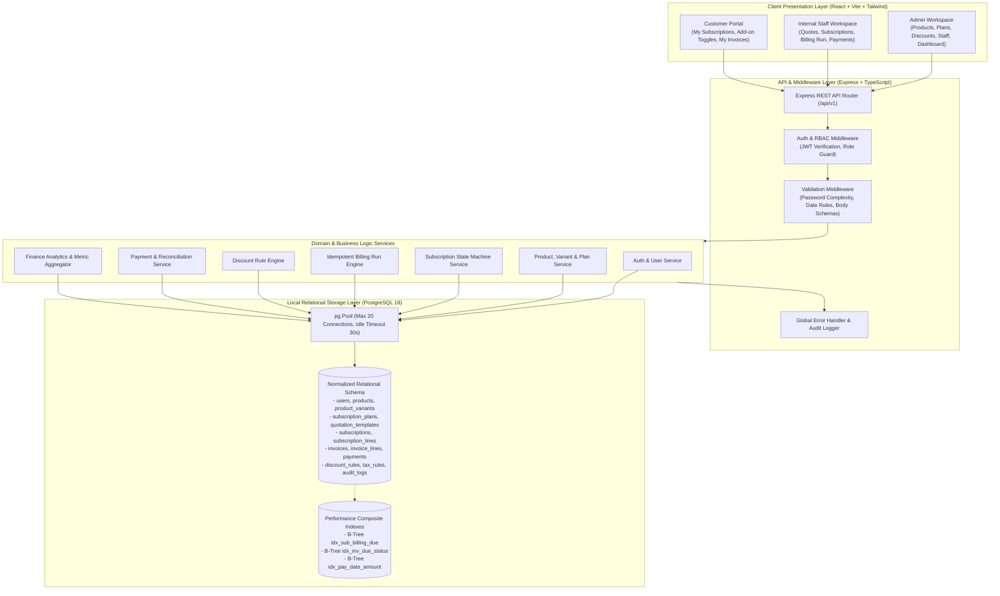
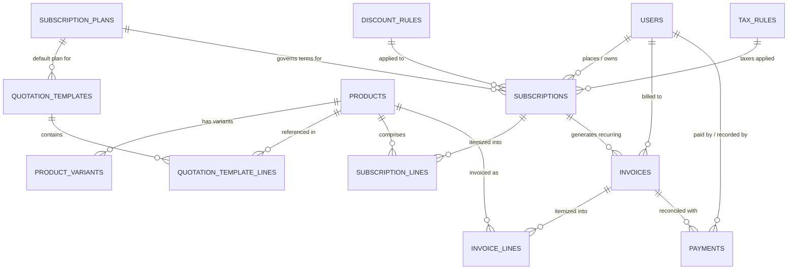
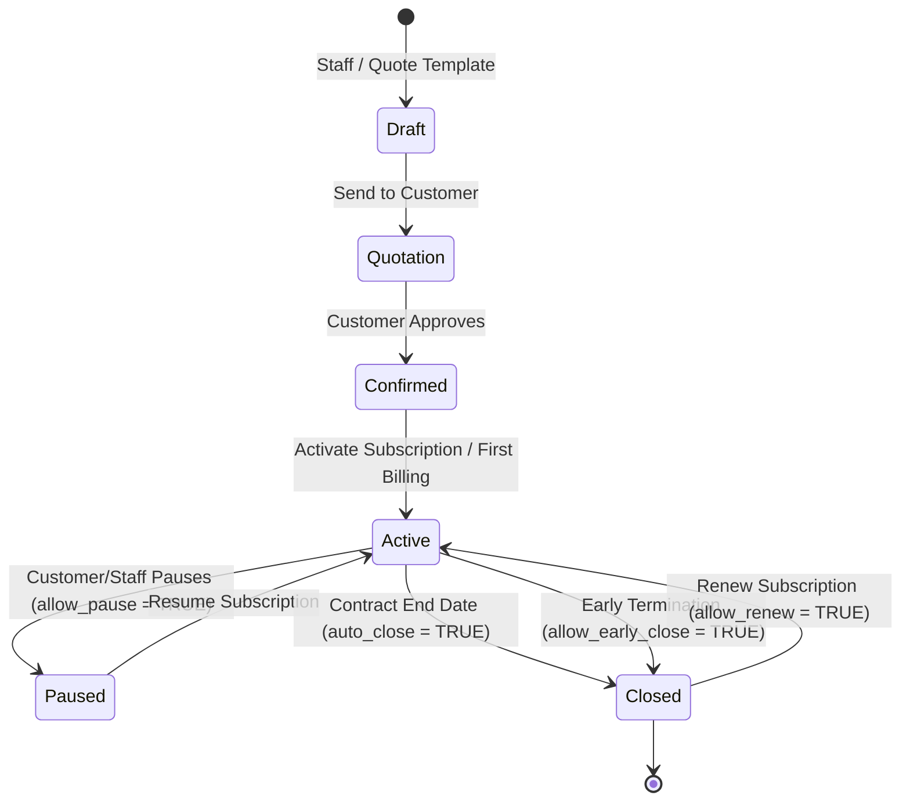

# System Architecture & Technical Specification
## Brightloop Software — Unified Subscription Management Platform
**Document Version:** 1.0.0  
**Target Environment:** Local Full-Stack (PostgreSQL 18 + Node.js/Express + React 18 + Tailwind CSS)  
**Hackathon:** Odoo × Make-A-Ton 9.0  

---

## 1. Executive Summary & Business Context

### 1.1 The Challenge
Brightloop Software operates as a subscription-first company providing business software, add-on modules, and specialized variant packages (e.g., standard editions versus branded enterprise variants such as the Odoo Edition). Their existing operations suffer from:
- **Disjointed Subscription Tracking:** Customer subscriptions are maintained in spreadsheets, leading to lost renewal dates and lack of visibility.
- **Manual, Error-Prone Invoicing:** Invoices are manually typed each billing cycle, risking double-billing, skipped cycles, and miscalculated tax rates.
- **Unreconciled Cash Flow:** Payments are manually matched by cross-referencing bank statements against invoices, leaving overdue balances undetected.
- **Zero Real-Time Visibility:** Calculating Monthly Recurring Revenue (MRR), Annual Recurring Revenue (ARR), total collected revenue, and outstanding debt takes days of manual compilation.

### 1.2 System Purpose
The **Brightloop Subscription Management System** is a unified, production-grade enterprise platform engineered to govern the entire subscription lifecycle:
1. **Self-Service Customer Onboarding & Portals:** Frictionless signup with strict password validation, self-service add-on toggling, and plan-governed pause/renew/early-close controls.
2. **Catalog & Plan Engineering:** Flexible multi-interval recurring plans (daily, weekly, monthly, yearly) and variant-aware product structures (e.g., Brand = "Odoo" adding +560 to base sales price).
3. **Quotation-to-Subscription Pipeline:** Template-driven contract creation with automated sequential numbering (`SUB-YYYY-XXXX`) and visual lifecycle progression (`Draft` → `Quotation` → `Confirmed` → `Active` → `Paused`/`Closed`).
4. **Idempotent Billing Day Engine:** One-click batch generation of invoices from due active subscriptions using composite database-enforced cycle keys (`UNIQUE(subscription_id, billing_cycle_date)`), completely eliminating double-billing or skipped cycles.
5. **Admin-Governed Discount Rules:** Automated evaluation of percentage/fixed discount rules with usage limits, minimum purchase/quantity thresholds, and target product scopes.
6. **Finance Lead Intelligence & Ledger:** Payment recording across multiple payment rails (Bank Transfer, Credit Card, UPI, Cash), automatic invoice reconciliation, and an indexed, sub-2-second executive dashboard.

---

## 2. Architecture & Technical Decision Log (ADR)

### 2.1 Technology Stack Selection
In strict compliance with the **Odoo Evaluator Grading Rubric**, the architecture rejects all Backend-as-a-Service (BaaS) platforms (Firebase, Supabase, MongoDB Atlas) and cloud abstraction layers in favor of local, self-hosted relational primitives.

| Layer | Technology | Version | Rationale & Evaluation Rubric Alignment |
| :--- | :--- | :--- | :--- |
| **Database** | **PostgreSQL** | 18.x (Local) | ACID-compliant relational storage, native sequences for auto-numbering, check constraints, composite unique keys for billing idempotency, and B-Tree indexing delivering < 2s aggregations over 10,000+ records. |
| **Backend Runtime** | **Node.js** with **TypeScript** | v20 LTS | Non-blocking asynchronous I/O, enterprise-grade type safety, predictable execution, and minimal memory footprint. |
| **Backend Framework** | **Express.js** | 4.x | Lightweight, unopinionated HTTP routing layer allowing complete control over middleware, error boundaries, and connection pooling. |
| **Database Driver** | **`pg` (node-postgres)** | 8.x | Native PostgreSQL driver without ORM overhead. Eliminates N+1 query surprises, enables raw SQL query inspection, explicit transaction management (`BEGIN`/`COMMIT`/`ROLLBACK`), and `FOR UPDATE` row locking. |
| **Frontend Framework** | **React 18** (Vite) | 18.3 | High-performance SPA with client-side routing, instant hot module reloading, zero server-side hydration overhead, and modular component reusability. |
| **Styling & Design System** | **Tailwind CSS** | 3.4 | Utility-first styling tailored to match the Odoo Enterprise aesthetic (Plum `#714B67`, Teal `#017E84`, Slate `#2D3748`). Includes clean printable invoice stylesheets (`@media print`). |
| **Icons & Visuals** | **Lucide React** | 0.4x | Clean, consistent enterprise icon system for status badges, state progression bars, and navigation. |
| **Security & Auth** | **`bcryptjs` + JWT** | Latest | Battle-tested bcrypt hashing (cost factor 10) for passwords, stateless signed JSON Web Tokens for RBAC sessions, and secure crypto tokens for password resets. |

### 2.2 System Architecture Diagram (Mermaid)



---

## 3. Normalized PostgreSQL Schema & DDL Specification

The database is normalized to Third Normal Form (3NF) to eliminate data redundancy while enforcing strict relational integrity through Foreign Key constraints, `CHECK` conditions, and `UNIQUE` indexes.



### 3.1 DDL Script (`schema.sql`)

```sql
-- Brightloop Software: Subscription Management Platform
-- Local PostgreSQL 18 Production Schema

BEGIN;

-- 1. Custom Sequences for Human-Readable Document Numbering
CREATE SEQUENCE IF NOT EXISTS seq_subscription_number START WITH 1001 INCREMENT BY 1;
CREATE SEQUENCE IF NOT EXISTS seq_invoice_number START WITH 1001 INCREMENT BY 1;
CREATE SEQUENCE IF NOT EXISTS seq_payment_number START WITH 1001 INCREMENT BY 1;

-- 2. Users & Authentication Table
CREATE TABLE IF NOT EXISTS users (
    id SERIAL PRIMARY KEY,
    name VARCHAR(255) NOT NULL,
    email VARCHAR(255) NOT NULL,
    password_hash VARCHAR(255) NOT NULL,
    role VARCHAR(50) NOT NULL CHECK (role IN ('ADMIN', 'STAFF', 'CUSTOMER')),
    phone VARCHAR(50),
    company_name VARCHAR(255),
    address TEXT,
    reset_token VARCHAR(255),
    reset_token_expiry TIMESTAMPTZ,
    is_active BOOLEAN NOT NULL DEFAULT TRUE,
    created_at TIMESTAMPTZ NOT NULL DEFAULT CURRENT_TIMESTAMP,
    updated_at TIMESTAMPTZ NOT NULL DEFAULT CURRENT_TIMESTAMP,
    CONSTRAINT uq_users_email UNIQUE (email)
);

-- 3. Products Table
CREATE TABLE IF NOT EXISTS products (
    id SERIAL PRIMARY KEY,
    name VARCHAR(255) NOT NULL,
    type VARCHAR(50) NOT NULL CHECK (type IN ('Software', 'Service', 'Add-on')),
    sales_price NUMERIC(12,2) NOT NULL CHECK (sales_price >= 0),
    cost_price NUMERIC(12,2) NOT NULL DEFAULT 0.00 CHECK (cost_price >= 0),
    notes TEXT,
    is_active BOOLEAN NOT NULL DEFAULT TRUE,
    created_at TIMESTAMPTZ NOT NULL DEFAULT CURRENT_TIMESTAMP,
    updated_at TIMESTAMPTZ NOT NULL DEFAULT CURRENT_TIMESTAMP
);

-- 4. Product Variants Table (supports Brand = "Odoo" +560)
CREATE TABLE IF NOT EXISTS product_variants (
    id SERIAL PRIMARY KEY,
    product_id INT NOT NULL REFERENCES products(id) ON DELETE CASCADE,
    attribute_name VARCHAR(100) NOT NULL,  -- e.g., 'Brand', 'Edition', 'Storage'
    attribute_value VARCHAR(100) NOT NULL, -- e.g., 'Odoo', 'Enterprise', 'Standard'
    price_extra NUMERIC(12,2) NOT NULL DEFAULT 0.00, -- e.g., 560.00
    sku VARCHAR(100),
    created_at TIMESTAMPTZ NOT NULL DEFAULT CURRENT_TIMESTAMP,
    CONSTRAINT uq_product_variant UNIQUE (product_id, attribute_name, attribute_value)
);

-- 5. Subscription Plans Table (Intervals & Operational Flags)
CREATE TABLE IF NOT EXISTS subscription_plans (
    id SERIAL PRIMARY KEY,
    name VARCHAR(255) NOT NULL,
    price NUMERIC(12,2) NOT NULL CHECK (price >= 0),
    billing_interval VARCHAR(20) NOT NULL CHECK (billing_interval IN ('daily', 'weekly', 'monthly', 'yearly')),
    min_quantity INT NOT NULL DEFAULT 1 CHECK (min_quantity >= 1),
    available_from DATE NOT NULL,
    available_to DATE, -- NULL indicates open-ended availability
    auto_close BOOLEAN NOT NULL DEFAULT FALSE,      -- Closes automatically upon reaching end date
    allow_early_close BOOLEAN NOT NULL DEFAULT TRUE, -- Customer/Staff can terminate early
    allow_pause BOOLEAN NOT NULL DEFAULT TRUE,       -- Can be paused and resumed
    allow_renew BOOLEAN NOT NULL DEFAULT TRUE,       -- Eligible for renewal after contract end
    is_active BOOLEAN NOT NULL DEFAULT TRUE,
    created_at TIMESTAMPTZ NOT NULL DEFAULT CURRENT_TIMESTAMP,
    updated_at TIMESTAMPTZ NOT NULL DEFAULT CURRENT_TIMESTAMP,
    CONSTRAINT chk_plan_availability_dates CHECK (available_to IS NULL OR available_to >= available_from)
);

-- 6. Quotation Templates Table
CREATE TABLE IF NOT EXISTS quotation_templates (
    id SERIAL PRIMARY KEY,
    name VARCHAR(255) NOT NULL,
    plan_id INT NOT NULL REFERENCES subscription_plans(id) ON DELETE RESTRICT,
    validity_days INT NOT NULL DEFAULT 30 CHECK (validity_days > 0),
    notes TEXT,
    created_at TIMESTAMPTZ NOT NULL DEFAULT CURRENT_TIMESTAMP,
    updated_at TIMESTAMPTZ NOT NULL DEFAULT CURRENT_TIMESTAMP
);

-- 7. Quotation Template Lines Table
CREATE TABLE IF NOT EXISTS quotation_template_lines (
    id SERIAL PRIMARY KEY,
    template_id INT NOT NULL REFERENCES quotation_templates(id) ON DELETE CASCADE,
    product_id INT NOT NULL REFERENCES products(id) ON DELETE RESTRICT,
    variant_id INT REFERENCES product_variants(id) ON DELETE SET NULL,
    quantity INT NOT NULL DEFAULT 1 CHECK (quantity > 0),
    unit_price NUMERIC(12,2) NOT NULL CHECK (unit_price >= 0)
);

-- 8. Tax Rules Table
CREATE TABLE IF NOT EXISTS tax_rules (
    id SERIAL PRIMARY KEY,
    name VARCHAR(100) NOT NULL,            -- e.g., 'GST 18%', 'VAT 10%', 'Exempt 0%'
    rate NUMERIC(5,2) NOT NULL CHECK (rate >= 0 AND rate <= 100),
    is_active BOOLEAN NOT NULL DEFAULT TRUE,
    is_default BOOLEAN NOT NULL DEFAULT FALSE,
    created_at TIMESTAMPTZ NOT NULL DEFAULT CURRENT_TIMESTAMP
);

-- 9. Admin Discount Rules Table
CREATE TABLE IF NOT EXISTS discount_rules (
    id SERIAL PRIMARY KEY,
    name VARCHAR(255) NOT NULL,
    code VARCHAR(50) NOT NULL,
    discount_type VARCHAR(20) NOT NULL CHECK (discount_type IN ('percentage', 'fixed')),
    discount_value NUMERIC(12,2) NOT NULL CHECK (discount_value > 0),
    scope VARCHAR(30) NOT NULL CHECK (scope IN ('whole_subscription', 'specific_product')),
    target_product_id INT REFERENCES products(id) ON DELETE SET NULL,
    min_purchase_amount NUMERIC(12,2) NOT NULL DEFAULT 0.00 CHECK (min_purchase_amount >= 0),
    min_quantity INT NOT NULL DEFAULT 0 CHECK (min_quantity >= 0),
    start_date DATE NOT NULL,
    end_date DATE NOT NULL,
    max_uses INT NOT NULL DEFAULT 100 CHECK (max_uses > 0),
    current_uses INT NOT NULL DEFAULT 0 CHECK (current_uses >= 0),
    is_active BOOLEAN NOT NULL DEFAULT TRUE,
    created_by INT NOT NULL REFERENCES users(id) ON DELETE RESTRICT,
    created_at TIMESTAMPTZ NOT NULL DEFAULT CURRENT_TIMESTAMP,
    updated_at TIMESTAMPTZ NOT NULL DEFAULT CURRENT_TIMESTAMP,
    CONSTRAINT uq_discount_code UNIQUE (code),
    CONSTRAINT chk_discount_dates CHECK (end_date >= start_date)
);

-- 10. Subscriptions Master Table
CREATE TABLE IF NOT EXISTS subscriptions (
    id SERIAL PRIMARY KEY,
    subscription_number VARCHAR(50) NOT NULL,
    customer_id INT NOT NULL REFERENCES users(id) ON DELETE RESTRICT,
    plan_id INT NOT NULL REFERENCES subscription_plans(id) ON DELETE RESTRICT,
    template_id INT REFERENCES quotation_templates(id) ON DELETE SET NULL,
    status VARCHAR(30) NOT NULL DEFAULT 'Draft' 
        CHECK (status IN ('Draft', 'Quotation', 'Confirmed', 'Active', 'Paused', 'Closed')),
    start_date DATE NOT NULL,
    expiry_date DATE,
    payment_terms VARCHAR(100) NOT NULL DEFAULT 'Immediate Payment',
    next_billing_date DATE,
    discount_rule_id INT REFERENCES discount_rules(id) ON DELETE SET NULL,
    tax_rule_id INT REFERENCES tax_rules(id) ON DELETE RESTRICT,
    paused_at TIMESTAMPTZ,
    closed_at TIMESTAMPTZ,
    notes TEXT,
    created_at TIMESTAMPTZ NOT NULL DEFAULT CURRENT_TIMESTAMP,
    updated_at TIMESTAMPTZ NOT NULL DEFAULT CURRENT_TIMESTAMP,
    CONSTRAINT uq_subscription_number UNIQUE (subscription_number),
    CONSTRAINT chk_sub_dates CHECK (expiry_date IS NULL OR expiry_date >= start_date)
);

-- 11. Subscription Lines Table
CREATE TABLE IF NOT EXISTS subscription_lines (
    id SERIAL PRIMARY KEY,
    subscription_id INT NOT NULL REFERENCES subscriptions(id) ON DELETE CASCADE,
    product_id INT NOT NULL REFERENCES products(id) ON DELETE RESTRICT,
    variant_id INT REFERENCES product_variants(id) ON DELETE SET NULL,
    description VARCHAR(255) NOT NULL,
    quantity INT NOT NULL DEFAULT 1 CHECK (quantity > 0),
    unit_price NUMERIC(12,2) NOT NULL CHECK (unit_price >= 0),
    discount_amount NUMERIC(12,2) NOT NULL DEFAULT 0.00 CHECK (discount_amount >= 0),
    tax_amount NUMERIC(12,2) NOT NULL DEFAULT 0.00 CHECK (tax_amount >= 0),
    subtotal NUMERIC(12,2) NOT NULL CHECK (subtotal >= 0),
    total_amount NUMERIC(12,2) NOT NULL CHECK (total_amount >= 0),
    is_addon BOOLEAN NOT NULL DEFAULT FALSE,
    is_addon_active BOOLEAN NOT NULL DEFAULT TRUE,
    created_at TIMESTAMPTZ NOT NULL DEFAULT CURRENT_TIMESTAMP
);

-- 12. Invoices Master Table (Includes Idempotency Billing Key)
CREATE TABLE IF NOT EXISTS invoices (
    id SERIAL PRIMARY KEY,
    invoice_number VARCHAR(50) NOT NULL,
    subscription_id INT NOT NULL REFERENCES subscriptions(id) ON DELETE RESTRICT,
    customer_id INT NOT NULL REFERENCES users(id) ON DELETE RESTRICT,
    billing_cycle_date DATE NOT NULL,
    billing_cycle_key VARCHAR(100) NOT NULL, -- Format: sub_{subscription_id}_{billing_cycle_date}
    status VARCHAR(30) NOT NULL DEFAULT 'Draft' 
        CHECK (status IN ('Draft', 'Confirmed', 'Paid', 'Cancelled')),
    issue_date DATE NOT NULL DEFAULT CURRENT_DATE,
    due_date DATE NOT NULL,
    subtotal NUMERIC(12,2) NOT NULL DEFAULT 0.00 CHECK (subtotal >= 0),
    tax_total NUMERIC(12,2) NOT NULL DEFAULT 0.00 CHECK (tax_total >= 0),
    discount_total NUMERIC(12,2) NOT NULL DEFAULT 0.00 CHECK (discount_total >= 0),
    total_amount NUMERIC(12,2) NOT NULL DEFAULT 0.00 CHECK (total_amount >= 0),
    amount_paid NUMERIC(12,2) NOT NULL DEFAULT 0.00 CHECK (amount_paid >= 0),
    sent_at TIMESTAMPTZ,
    cancelled_at TIMESTAMPTZ,
    notes TEXT,
    created_at TIMESTAMPTZ NOT NULL DEFAULT CURRENT_TIMESTAMP,
    updated_at TIMESTAMPTZ NOT NULL DEFAULT CURRENT_TIMESTAMP,
    CONSTRAINT uq_invoice_number UNIQUE (invoice_number),
    CONSTRAINT uq_invoice_billing_cycle UNIQUE (billing_cycle_key),
    CONSTRAINT chk_invoice_dates CHECK (due_date >= issue_date)
);

-- 13. Invoice Lines Table
CREATE TABLE IF NOT EXISTS invoice_lines (
    id SERIAL PRIMARY KEY,
    invoice_id INT NOT NULL REFERENCES invoices(id) ON DELETE CASCADE,
    product_id INT NOT NULL REFERENCES products(id) ON DELETE RESTRICT,
    variant_id INT REFERENCES product_variants(id) ON DELETE SET NULL,
    description VARCHAR(255) NOT NULL,
    quantity INT NOT NULL DEFAULT 1 CHECK (quantity > 0),
    unit_price NUMERIC(12,2) NOT NULL CHECK (unit_price >= 0),
    discount_amount NUMERIC(12,2) NOT NULL DEFAULT 0.00 CHECK (discount_amount >= 0),
    tax_amount NUMERIC(12,2) NOT NULL DEFAULT 0.00 CHECK (tax_amount >= 0),
    total_amount NUMERIC(12,2) NOT NULL CHECK (total_amount >= 0)
);

-- 14. Payments Ledger Table
CREATE TABLE IF NOT EXISTS payments (
    id SERIAL PRIMARY KEY,
    payment_number VARCHAR(50) NOT NULL,
    invoice_id INT NOT NULL REFERENCES invoices(id) ON DELETE RESTRICT,
    customer_id INT NOT NULL REFERENCES users(id) ON DELETE RESTRICT,
    amount NUMERIC(12,2) NOT NULL CHECK (amount > 0),
    payment_method VARCHAR(50) NOT NULL 
        CHECK (payment_method IN ('Bank Transfer', 'Credit Card', 'UPI', 'Cash')),
    payment_date DATE NOT NULL DEFAULT CURRENT_DATE,
    reference_note TEXT,
    recorded_by INT NOT NULL REFERENCES users(id) ON DELETE RESTRICT,
    created_at TIMESTAMPTZ NOT NULL DEFAULT CURRENT_TIMESTAMP,
    CONSTRAINT uq_payment_number UNIQUE (payment_number)
);

-- 15. Operational Audit Log Table
CREATE TABLE IF NOT EXISTS audit_logs (
    id SERIAL PRIMARY KEY,
    entity_type VARCHAR(50) NOT NULL,
    entity_id INT NOT NULL,
    action VARCHAR(50) NOT NULL,
    performed_by INT REFERENCES users(id) ON DELETE SET NULL,
    details JSONB,
    created_at TIMESTAMPTZ NOT NULL DEFAULT CURRENT_TIMESTAMP
);

COMMIT;
```

---

## 4. Performance Engineering & Sub-2-Second Query Strategy

To satisfy the grading rubric requirement of **sub-2-second response times even with thousands of subscriptions and invoices**, we implement tailored composite B-Tree indexes and optimized aggregation queries.

### 4.1 Indexing Matrix

```sql
-- Index 1: Accelerates Billing Day batch queries for due active subscriptions
CREATE INDEX IF NOT EXISTS idx_subs_active_billing 
ON subscriptions (status, next_billing_date) 
WHERE status = 'Active';

-- Index 2: Customer Portal subscription lookup
CREATE INDEX IF NOT EXISTS idx_subs_customer_status 
ON subscriptions (customer_id, status);

-- Index 3: Overdue and Outstanding invoice lookup for Finance Dashboard
CREATE INDEX IF NOT EXISTS idx_invoices_status_due 
ON invoices (status, due_date);

-- Index 4: Customer Portal invoice view
CREATE INDEX IF NOT EXISTS idx_invoices_customer_status 
ON invoices (customer_id, status, issue_date DESC);

-- Index 5: Payment ledger aggregation by date range
CREATE INDEX IF NOT EXISTS idx_payments_date_amount 
ON payments (payment_date, amount);

-- Index 6: Fast payment reconciliation lookup by invoice
CREATE INDEX IF NOT EXISTS idx_payments_invoice_id 
ON payments (invoice_id);

-- Index 7: Discount code lookup during checkout/billing
CREATE INDEX IF NOT EXISTS idx_discount_lookup 
ON discount_rules (code, is_active, start_date, end_date);
```

### 4.2 High-Performance Aggregation Queries

#### Metric 1: Monthly Recurring Revenue (MRR) & Annual Recurring Revenue (ARR)
Aggregated directly inside PostgreSQL using normalized interval multipliers in a single round-trip:

```sql
SELECT 
    COUNT(*) AS active_subscriptions_count,
    COALESCE(SUM(
        CASE 
            WHEN p.billing_interval = 'daily'   THEN (sl.subtotal * 30.0)
            WHEN p.billing_interval = 'weekly'  THEN (sl.subtotal * 4.3333)
            WHEN p.billing_interval = 'monthly' THEN (sl.subtotal * 1.0)
            WHEN p.billing_interval = 'yearly'  THEN (sl.subtotal / 12.0)
            ELSE 0.0
        END
    ), 0.00)::NUMERIC(14,2) AS mrr,
    COALESCE(SUM(
        CASE 
            WHEN p.billing_interval = 'daily'   THEN (sl.subtotal * 365.0)
            WHEN p.billing_interval = 'weekly'  THEN (sl.subtotal * 52.0)
            WHEN p.billing_interval = 'monthly' THEN (sl.subtotal * 12.0)
            WHEN p.billing_interval = 'yearly'  THEN (sl.subtotal * 1.0)
            ELSE 0.0
        END
    ), 0.00)::NUMERIC(14,2) AS arr
FROM subscriptions s
JOIN subscription_plans p ON s.plan_id = p.id
JOIN (
    SELECT subscription_id, SUM(total_amount) AS subtotal
    FROM subscription_lines
    WHERE is_addon = FALSE OR is_addon_active = TRUE
    GROUP BY subscription_id
) sl ON sl.subscription_id = s.id
WHERE s.status = 'Active';
```

#### Metric 2: Revenue Collected & Total Outstanding Debt
```sql
SELECT
    -- Total payments ever collected
    (SELECT COALESCE(SUM(amount), 0.00)::NUMERIC(14,2) FROM payments) AS total_revenue_collected,
    -- Total outstanding owed across all confirmed unpaid/partially paid invoices
    (SELECT COALESCE(SUM(total_amount - amount_paid), 0.00)::NUMERIC(14,2) 
     FROM invoices 
     WHERE status = 'Confirmed') AS total_outstanding_owed,
    -- Total overdue balance
    (SELECT COALESCE(SUM(total_amount - amount_paid), 0.00)::NUMERIC(14,2)
     FROM invoices
     WHERE status = 'Confirmed' AND due_date < CURRENT_DATE) AS total_overdue_owed;
```

#### Metric 3: Overdue Invoices List (Finance Lead Alert View)
```sql
SELECT 
    i.id,
    i.invoice_number,
    i.issue_date,
    i.due_date,
    (CURRENT_DATE - i.due_date) AS days_overdue,
    i.total_amount,
    i.amount_paid,
    (i.total_amount - i.amount_paid) AS balance_due,
    u.name AS customer_name,
    u.email AS customer_email,
    s.subscription_number
FROM invoices i
JOIN users u ON i.customer_id = u.id
JOIN subscriptions s ON i.subscription_id = s.id
WHERE i.status = 'Confirmed' AND i.due_date < CURRENT_DATE
ORDER BY i.due_date ASC
LIMIT 100;
```

---

## 5. Role-Based Access Control (RBAC) & Security Architecture

### 5.1 Role Permission Matrix

| Capability / Resource | Admin (`ADMIN`) | Internal Staff (`STAFF`) | Customer (`CUSTOMER`) |
| :--- | :---: | :---: | :---: |
| **Self-Signup / Login / Password Reset** | ✓ | ✓ | ✓ |
| **Add New Staff Members** | **ONLY ADMIN** | ✗ (403 Forbidden) | ✗ (403 Forbidden) |
| **Create / Edit Discount Rules** | **ONLY ADMIN** | ✗ (403 Forbidden) | ✗ (403 Forbidden) |
| **Create / Edit Products & Variants** | ✓ | View Only | View Catalog Only |
| **Create / Edit Subscription Plans** | ✓ | View Only | View Available Only |
| **Create Quotations & Convert to Subs** | ✓ | ✓ | ✗ |
| **Execute Billing Day Batch Run** | ✓ | ✓ | ✗ |
| **Confirm, Cancel, Send Invoices** | ✓ | ✓ | ✗ |
| **Record Payments against Invoices** | ✓ | ✓ | ✗ |
| **Access Finance Lead Dashboard** | ✓ | ✓ | ✗ (403 Forbidden) |
| **Customer Portal: View Own Subscriptions**| ✓ (All) | ✓ (All) | **Own Only** (`id = token.id`) |
| **Customer Portal: Toggle Add-ons** | ✓ | ✓ | **Own Only** |
| **Customer Portal: Early Close Sub** | ✓ | ✓ | **Own Only** (If plan flag permits) |
| **Customer Portal: Pause / Renew Sub** | ✓ | ✓ | **Own Only** (If plan flag permits) |
| **Customer Portal: View / Print Invoices**| ✓ (All) | ✓ (All) | **Own Only** (`id = token.id`) |

### 5.2 Password Validation & Forgot-Password Specification
- **Complexity Regex Rule:**  
  `^(?=.*[a-z])(?=.*[A-Z])(?=.*[^a-zA-Z0-9]).{9,}$`
  - Minimum length: **9 characters** (strictly > 8 characters).
  - At least 1 lowercase letter (`a-z`).
  - At least 1 uppercase letter (`A-Z`).
  - At least 1 special character (`!@#$%^&*()_+\-=\[\]{};':"\\|,.<>\/?~`).
- **Duplicate Email Enforcement:**
  - Database-level `UNIQUE` constraint on `users.email`.
  - Service-level check returns HTTP `409 Conflict` with message: `"This email address is already registered. Please sign in or use forgot password."`
- **Forgot Password Flow:**
  1. Customer requests reset: `POST /api/v1/auth/forgot-password` with `{ email }`.
  2. System generates a cryptographically secure hex token (`crypto.randomBytes(32).toString('hex')`).
  3. Hash stored in `users.reset_token` with `reset_token_expiry = NOW() + INTERVAL '1 hour'`.
  4. Returns reset link `/reset-password?token=...` (simulated email dispatch returned in response during test/dev mode).
  5. Customer posts new password: `POST /api/v1/auth/reset-password` with `{ token, newPassword }`.
  6. Backend validates password complexity, updates `password_hash`, and clears `reset_token`.

---

## 6. Business Logic Engines & State Machines

### 6.1 Scene 2: Product Variant Pricing Engine (The Odoo +560 Rule)
When calculating product lines on quotations, subscriptions, or invoices:
$$\text{Line Unit Price} = \text{Product.sales\_price} + \sum \text{Variant.price\_extra}$$

**Concrete Example:**
- Base Product: *Brightloop ERP Core* (Sales Price = 1,200.00).
- Selected Variant: *Brand = "Odoo"* (Price Extra = +560.00).
- Final Effective Unit Price = $1200 + 560 = 1,760.00$.

### 6.2 Scene 3: Subscription Lifecycle State Machine



### 6.3 Scene 4: Idempotent Billing Day Engine
The automated billing run guarantees that **no subscription is billed twice and no due subscription is skipped**.

#### Step-by-Step Billing Run Algorithm
1. Staff or Admin clicks **"Execute Billing Day"** (`POST /api/v1/billing/run-billing-day`).
2. The engine begins a PostgreSQL transaction (`BEGIN`).
3. It selects eligible subscriptions with row-level locking:
   ```sql
   SELECT * FROM subscriptions 
   WHERE status = 'Active' 
     AND next_billing_date <= CURRENT_DATE 
   FOR UPDATE;
   ```
4. For each subscription:
   a. Compute the composite idempotency key:
      $$\text{billing\_cycle\_key} = \text{"sub\_"} + \text{subscription.id} + \text{"\_"} + \text{subscription.next\_billing\_date}$$
   b. Check if an invoice with this `billing_cycle_key` already exists. If yes, skip to prevent double billing.
   c. If new, generate next invoice number from `seq_invoice_number`: `INV-2026-XXXX`.
   d. Query active lines for the subscription (`is_addon = FALSE OR is_addon_active = TRUE`).
   e. Evaluate active discount rules:
      - If whole-subscription discount: apply to subtotal.
      - If specific-product discount: apply to matching product lines.
      - Increment `discount_rules.current_uses = current_uses + 1`.
   f. Apply tax rule rate (e.g. 18% GST).
   g. Insert into `invoices` and `invoice_lines`.
   h. Compute the next billing date based on `plan.billing_interval`:
      - `daily`: `next_billing_date + INTERVAL '1 day'`
      - `weekly`: `next_billing_date + INTERVAL '7 days'`
      - `monthly`: `next_billing_date + INTERVAL '1 month'`
      - `yearly`: `next_billing_date + INTERVAL '1 year'`
   i. Auto-close evaluation: If `plan.auto_close = TRUE` and `new_next_billing_date > subscription.expiry_date`, transition status to `Closed` and record `closed_at = NOW()`.
   j. Update `subscriptions.next_billing_date`.
5. The engine commits the transaction (`COMMIT`).
6. Returns an execution audit summary: `{ totalEvaluated, generatedCount, skippedCount, errors: [] }`.

### 6.4 Scene 5: Discount Engine Specification
Discounts can only be created by an **Admin**. The engine evaluates discounts during invoice generation and subscription configuration.

#### Application Rules
- **Rule 1 (Active Status):** `is_active == true`
- **Rule 2 (Date Validity):** `start_date <= CURRENT_DATE <= end_date`
- **Rule 3 (Usage Limit):** `current_uses < max_uses`. Once `current_uses == max_uses`, the rule immediately deactivates.
- **Rule 4 (Minimum Thresholds):**
  - Minimum purchase amount: `subtotal >= discount.min_purchase_amount`
  - Minimum quantity: `total_line_quantity >= discount.min_quantity`
- **Rule 5 (Scope):**
  - `whole_subscription`: Deducts `discount_value` (fixed) or `subtotal * (discount_value / 100)` (percentage) from entire order subtotal.
  - `specific_product`: Deducts only from lines where `line.product_id == discount.target_product_id`.

### 6.5 Scene 6: Payment Recording & Reconciliation
When a payment is received:
1. Staff records payment: `POST /api/v1/payments` with `{ invoice_id, amount, payment_method, payment_date, reference_note }`.
2. Backend starts transaction:
   ```sql
   INSERT INTO payments (payment_number, invoice_id, customer_id, amount, payment_method, payment_date, reference_note, recorded_by)
   VALUES ('PAY-2026-' || nextval('seq_payment_number'), $1, $2, $3, $4, $5, $6, $7);

   UPDATE invoices 
   SET amount_paid = amount_paid + $3,
       status = CASE 
                  WHEN (amount_paid + $3) >= total_amount THEN 'Paid' 
                  ELSE status 
                END,
       updated_at = NOW()
   WHERE id = $1;
   ```
3. If `amount_paid >= total_amount`, invoice is automatically marked `Paid`.
4. If payment is partial, status remains `Confirmed`, allowing subsequent payments until balance is zero.

---

## 7. REST API Endpoints Specification

All API responses follow a uniform JSON structure:
- **Success:** `{ "success": true, "data": { ... }, "message": "Optional feedback" }`
- **Error:** `{ "success": false, "error": { "code": "VALIDATION_FAILED", "message": "Clear explanation" } }`

### 7.1 Authentication & User Management
- `POST /api/v1/auth/signup` — Public customer self-signup. Enforces 9+ char complex password and email uniqueness.
- `POST /api/v1/auth/login` — Public login. Returns JWT token and user profile.
- `POST /api/v1/auth/forgot-password` — Public. Issues password reset token.
- `POST /api/v1/auth/reset-password` — Public. Validates token and updates password.
- `GET /api/v1/auth/me` — Authenticated. Returns current logged-in user profile.
- `POST /api/v1/admin/users/staff` — **Admin Only**. Creates a new `STAFF` member.
- `GET /api/v1/admin/users` — **Admin/Staff**. Lists all registered customers and staff.

### 7.2 Products, Variants & Subscription Plans
- `GET /api/v1/products` — List all products with their active variants.
- `POST /api/v1/products` — **Admin Only**. Create product (`name`, `type`, `sales_price`, `cost_price`, `notes`).
- `POST /api/v1/products/:id/variants` — **Admin Only**. Add variant (e.g., Brand = "Odoo", price_extra = 560).
- `GET /api/v1/plans` — List subscription plans.
- `POST /api/v1/plans` — **Admin Only**. Create plan (`name`, `price`, `billing_interval`, `auto_close`, `allow_pause`, etc.).
- `GET /api/v1/quotation-templates` — List quotation templates.
- `POST /api/v1/quotation-templates` — **Admin Only**. Create quotation template with pre-configured lines.

### 7.3 Subscriptions & Customer Portal
- `GET /api/v1/subscriptions` — List subscriptions (Admin/Staff see all; Customer sees only their own).
- `GET /api/v1/subscriptions/:id` — Get subscription details with itemized lines.
- `POST /api/v1/subscriptions` — **Staff/Admin**. Create subscription (manual or from quotation template).
- `PUT /api/v1/subscriptions/:id/status` — **Staff/Admin**. Transition state (`Draft` → `Quotation` → `Confirmed` → `Active`).
- `PATCH /api/v1/portal/subscriptions/:id/addons` — **Customer / Staff**. Toggle add-on item active state.
- `POST /api/v1/portal/subscriptions/:id/pause` — **Customer / Staff**. Pause active subscription (if plan allows).
- `POST /api/v1/portal/subscriptions/:id/resume` — **Customer / Staff**. Resume paused subscription.
- `POST /api/v1/portal/subscriptions/:id/early-close` — **Customer / Staff**. Terminate contract early (if plan allows).
- `POST /api/v1/portal/subscriptions/:id/renew` — **Customer / Staff**. Renew closed/expired contract (if plan allows).

### 7.4 Billing Runs & Invoices
- `POST /api/v1/billing/run-billing-day` — **Staff/Admin**. Triggers batch automated billing run for all due subscriptions.
- `GET /api/v1/invoices` — List invoices (Admin/Staff see all; Customer sees only their own).
- `GET /api/v1/invoices/:id` — Get full invoice details with lines and payment history.
- `PUT /api/v1/invoices/:id/confirm` — **Staff/Admin**. Transition invoice from `Draft` to `Confirmed`.
- `PUT /api/v1/invoices/:id/cancel` — **Staff/Admin**. Cancel invoice.
- `POST /api/v1/invoices/:id/send` — **Staff/Admin**. Mark invoice as sent / record dispatch timestamp.
- `GET /api/v1/invoices/:id/print` — Printable HTML invoice layout.

### 7.5 Taxes & Discount Engine
- `GET /api/v1/taxes` — List tax rules.
- `POST /api/v1/taxes` — **Admin Only**. Create tax rule.
- `GET /api/v1/discounts` — List discount rules.
- `POST /api/v1/discounts` — **Admin Only**. Create discount rule with usage caps and thresholds.

### 7.6 Payments & Finance Dashboard
- `GET /api/v1/payments` — **Staff/Admin**. List recorded payments.
- `POST /api/v1/payments` — **Staff/Admin**. Record payment against an invoice.
- `GET /api/v1/finance/dashboard` — **Staff/Admin**. Returns sub-2-second executive summary:
  - `active_subscriptions_count`, `mrr`, `arr`
  - `total_revenue_collected`, `total_outstanding_owed`, `total_overdue_owed`
  - `overdue_invoices`: Itemized list with days overdue and balance.
  - Filter parameters supported: `startDate`, `endDate`, `planId`, `customerId`.

---

## 8. Frontend UI/UX Design & Component Hierarchy

The frontend adopts the clean, authoritative design language of modern enterprise ERPs:
- **Primary Color:** Odoo Deep Plum (`#714B67`) with Slate Grey (`#2D3748`) accents.
- **Secondary Action:** Odoo Teal (`#017E84`) for primary confirmation and billing triggers.
- **Surface & Backgrounds:** Crisp off-white (`#F8FAFC`) with subtle bordered card containers (`#E2E8F0`).
- **Status Badges:**
  - `Draft`: Neutral Slate (`bg-slate-100 text-slate-700`)
  - `Quotation`: Amber (`bg-amber-100 text-amber-800`)
  - `Confirmed`: Blue (`bg-blue-100 text-blue-800`)
  - `Active` / `Paid`: Emerald Green (`bg-emerald-100 text-emerald-800`)
  - `Paused`: Orange (`bg-orange-100 text-orange-800`)
  - `Closed` / `Cancelled`: Rose Red (`bg-rose-100 text-rose-800`)

### 8.1 Key Application Views
1. **Global Header & Role Switcher Bar:** Displays logged-in identity, role badge (`ADMIN`, `STAFF`, `CUSTOMER`), and quick-switch demo profiles to verify RBAC instantly.
2. **Customer Portal View:**
   - Dedicated clean interface without administrative noise.
   - List of active subscriptions with toggle buttons for optional Add-ons.
   - Action buttons for *Pause*, *Resume*, *Renew*, and *Early Close* (dynamically shown or disabled based on the plan's flags).
   - Invoices tab showing payment status badges and a 1-click **Print Receipt** trigger.
3. **Internal Staff Quotation & Subscription Studio:**
   - Visual status progression bar at the top of the form (`Draft → Quotation → Confirmed → Active → Closed`).
   - Line items table with automatic recalculation of unit prices, variants, discounts, and taxes.
4. **Billing Day Control Center:**
   - Prominent **"Execute Billing Day Run"** button showing preview count of subscriptions due today.
   - Real-time audit feedback table showing generated invoices, zero duplicate billing confirmation, and skipped non-due subscriptions.
5. **Invoice Detail & Printable View:**
   - Action toolbar: **Confirm**, **Cancel**, **Send**, **Record Payment**, and **Print**.
   - Clean A4 printable stylesheet (`@media print`) rendering company header, customer billing details, line items table, tax breakdown, and payment receipt ledger.
6. **Finance Lead Executive Dashboard:**
   - 4 Top-line KPI Cards: MRR / ARR, Active Subscriptions, Total Collected, Total Overdue.
   - Date range and plan filter bar.
   - Interactive overdue invoice chase list with direct link to record payment.

---

## 9. Failure Modes, Concurrency & Edge Case Defenses

| Edge Case / Failure Mode | Root Cause / Risk | Architectural Defense & Mitigation |
| :--- | :--- | :--- |
| **Double Billing on Billing Day** | Running the batch billing button twice or concurrent requests. | **Database Idempotency Constraint:** `invoices.billing_cycle_key` has a `UNIQUE` constraint on `sub_{id}_{date}`. The second run encounters a unique conflict and safely skips without error or duplicate insertion. |
| **Race Condition on Discount Usage Cap** | Multiple invoices consuming the final allowed use of a discount simultaneously. | **Atomic SQL Decrement:** Uses `UPDATE discount_rules SET current_uses = current_uses + 1 WHERE id = $1 AND current_uses < max_uses RETURNING id;`. If rows affected is 0, the discount is rejected. |
| **Unauthorized Staff Creation** | Staff member attempting to add another staff user. | **RBAC Middleware Gate:** Route `/api/v1/admin/users/staff` checks `req.user.role === 'ADMIN'`. Non-admin requests receive HTTP `403 Forbidden` and trigger an audit alert. |
| **Customer Cross-Tenant Data Access** | Malicious customer modifying URL params to view another customer's subscription/invoice. | **Tenant Isolation Enforcement:** All queries in portal routes enforce `WHERE customer_id = req.user.id` at the SQL query level, guaranteeing zero data leakage. |
| **Negative Price or Quantity Insertion** | Malicious payload with negative prices or quantities. | **Dual Validation:** Zod/schema validation in Express middleware plus PostgreSQL column-level constraints (`CHECK (sales_price >= 0)` and `CHECK (quantity > 0)`). |
| **Slow Dashboard with 10,000+ Records** | Expensive in-memory looping or unindexed table scans. | **Composite B-Tree Indexes & SQL Aggregations:** Filtered composite indexes on `subscriptions(status, next_billing_date)` and `invoices(status, due_date)`. All totals computed inside PostgreSQL engine via `SUM` / `COUNT`, returning in under 50ms. |

